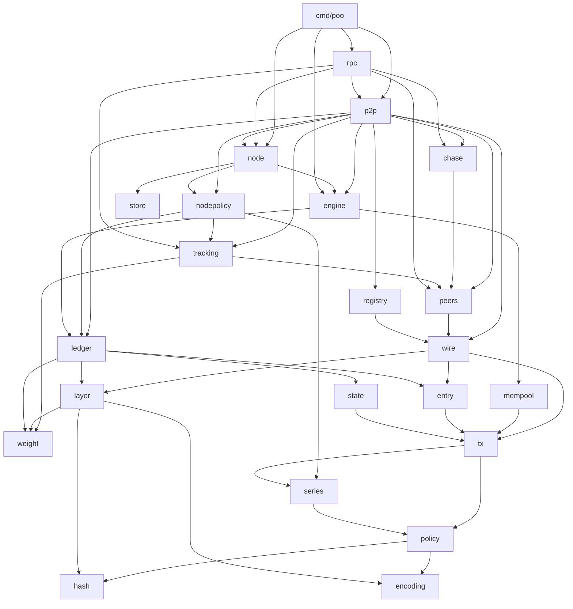
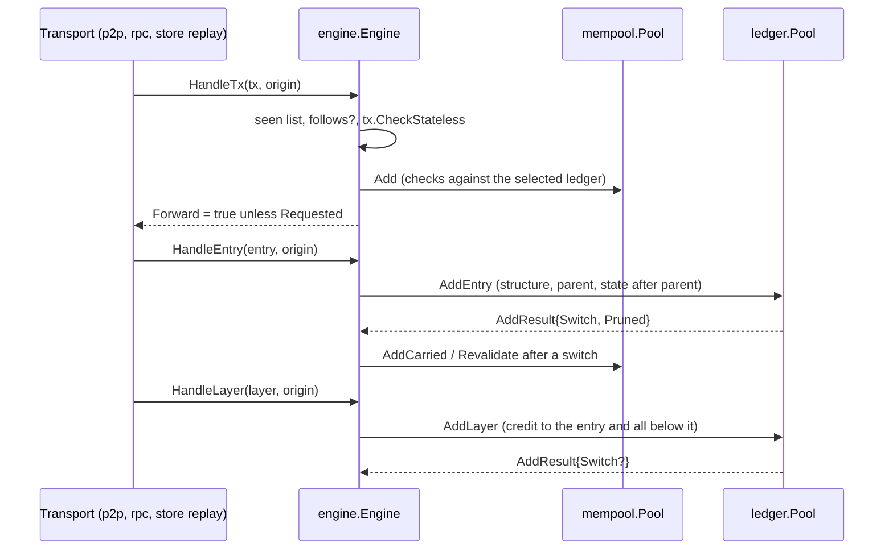

# Architecture

## Summary

This document maps the Proof of Ownership design onto the code. The code is a
stack of small Go packages. Each package depends only on packages below it,
and the design's three tiers of rules (consensus, series, node policy) each
have a fixed home. The consensus packages are pure: they read no clock, no
disk and no network, so the same inputs always give the same selected ledger.
`pkg/engine` is the boundary of the full node. It takes items (transactions,
entries, layers) from any transport, says whether to forward them, and
reports what changed. `pkg/node` wraps it with a data directory: the node
policy and a store per pool, replayed through the engine on start-up so
nothing on disk is trusted. `pkg/p2p` connects nodes over the wire protocol
of `pkg/wire`: it hands what peers send to the node and forwards what the
node keeps, and it never decides validity. `pkg/rpc` gives the owner local
control. Peer discovery (milestone 4) and peer management (milestone 5)
live in `pkg/p2p` too, with the peer book and ranking rules in
`pkg/peers`, bootstrap lists in `pkg/registry`, the record of what each
peer does in `pkg/tracking` and the queue of heavier ledgers to check in
`pkg/chase`. None of it leaks into the packages below the engine.

## Package layers

Arrows show imports; `hash`, `weight` and `encoding` import nothing from the
project. Every package above `policy` also imports `hash`, and most import
`encoding`; those edges are left out for readability.

| Layer | Packages | Holds |
| --- | --- | --- |
| Primitives | `encoding`, `hash`, `weight` | Byte form, hashes and strength, credit and weight |
| Series tier | `series`, `policy` | Published rules of a series, addresses, witnesses |
| Consensus tier | `tx`, `entry`, `layer`, `state`, `ledger` | Validity, weight, selection, switching |
| Node policy | `mempool`, `engine` (and their `Config`), `nodepolicy` | What to keep, follow and forward |
| Node | `store`, `node`, `rpc` | Disk, the data directory, local control |
| Network | `wire`, `peers`, `registry`, `tracking`, `chase`, `p2p` | Messages between full nodes, the peer book and ranking, bootstrap lists, peer tracking, the chase queue, discovery, forwarding, catch-up |
| Tools | `cmd/poo`, `vectors`, `testutil` | CLI, demo, published vectors, test helpers |

## The three tiers

The design asks two questions of every rule. If two nodes following the same
series disagreed on it, could they select different ledgers? If so, is it the
same for every series?

- **Consensus** rules are the same everywhere: what makes a transaction or an
  entry valid, how a layer's credit is computed, which ledger is selected,
  what happens to transactions when the selection switches.
- **Series** rules are fixed by the series and read through
  `*series.Series`: the hash, the number of mints, supply, pool size, the
  minimum layer and entry strengths, whether entry hashes count as credit,
  the allowed policy types and key algorithms, the witness ceiling and the
  optional issuer.
- **Node policy** may differ between nodes without anyone disagreeing about
  ownership: K (how many inactive branches to keep), how many pending
  transactions to hold, which series, pools and mints to follow, and when a
  receiver considers a payment final. It lives in `ledger.Config`,
  `engine.Config` and the arguments of `mempool.New`, with provisional
  defaults recorded in [decisions.md](decisions.md).

## Data flow through a full node

1. **Transactions** are checked without state first (series, serial range,
   amounts, addresses, witnesses for a claim). Then the pending pool checks
   them against the state of the selected ledger plus what is already
   pending. Pending transactions are first come, first served: a second
   spend of the same portion is refused, not swapped in.
2. **Entries** are checked for structure (pool, nonce, canonical order,
   minimum entry strength), then against the state just after their parent.
   The parent may be on any branch the node holds; `state` overlays make
   checking an entry on another branch cheap. An entry adds credit only if
   the series counts entry hashes.
3. **Layers** add credit to their entry and, by being part of every ledger
   that contains that entry, to every ledger built on it. A layer is valid
   only if its strength reaches the series minimum.
4. **Selection** keeps the heaviest valid ledger. The node switches only to
   a strictly heavier one; at equal weight it keeps the one it saw first.
5. **Switching** reverts the old segment, applies the new one, and sorts
   every transaction of the old segment into unchanged (also in the new
   one), carried (still valid, back to pending) or void (conflicts with the
   new ledger).
6. **Pruning** keeps the selected ledger, the top K other branches by
   weight, and a bounded number of branches tying the selected weight.

## The ledger tree

`ledger.Pool` keeps every held entry as a node in a tree rooted at the
pool_id. The selected chain is a slice of nodes. Prefix weights along it are
kept in a Fenwick tree so that a layer on an old entry costs O(log n) instead
of O(n). Nodes off the selected chain keep a weight relative to the point
where their branch leaves the chain, so a layer on the chain does not touch
them. Checking an entry on another branch replays only the segment from the
fork point, through an overlay on the current state.

## Where later milestones attach

- **Storage (M2, done)** wraps the engine in `pkg/node`: it appends every
  kept entry, layer and pending transaction to the pool's log and feeds
  them back through the `Handle*` calls, as `Stored`, on start-up.
  Consensus packages stay in memory and unaware of disk.
- **Wire protocol and forwarding (M3, done)**: `pkg/p2p` turns bytes into
  items with `pkg/wire`, calls the node with `Pushed` or `Requested` and
  the sending peer, and forwards what the node reports through its
  observers when the engine says to forward. Serving ledger data reads the
  engine through `Engine.Ledger`. See [modules/p2p.md](modules/p2p.md).
- **Peer discovery (M4, done)**: `pkg/p2p` verifies each peer's follows with
  follow requests, relays discovery requests, and keeps the peer book of
  `pkg/peers` (saved as `peers.json`) filled from peer lists, broadcasts and
  the registries of `pkg/registry`. See [modules/peers.md](modules/peers.md).
- **Peer management (M5, done)**: `pkg/p2p` sorts peers into priority,
  backup and candidate slots by points from `pkg/tracking`, handles their
  messages in that order, flags, times out and blocks misbehaving
  addresses, and chases heavier stated weights through `pkg/chase`,
  checking the work behind a branch before fetching it. Like discovery,
  it decides who to talk to and what to fetch, and never changes
  validity: the engine still switches only on weight it computed. See
  [modules/tracking.md](modules/tracking.md) and
  [modules/chase.md](modules/chase.md).

See [roadmap.md](roadmap.md) for the milestones and
[modules/README.md](modules/README.md) for one page per package.
