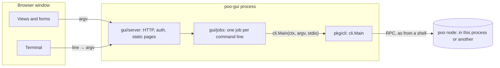

# The GUI

## Summary

The GUI (`poo-gui`) is a visual way to use the same headless node and the
same `poo` commands. It has no logic of its own. The headless code is the
source, and the GUI is built on top of it:

- Everything the GUI does, it does by running a `poo` command line through
  `cli.Main`, the function the `poo` binary runs. A button builds a command
  line, and a view runs a command and renders what it prints. Each view and
  form shows the command it runs, so the user can copy it to a shell.
- The GUI has a terminal that is the headless tool. A line typed there goes
  to `cli.Main` exactly as the same line typed after `poo` in a shell would.
  Anything the views do not cover yet is one line away.
- The GUI is its own Go module under `gui/`. It may import only the
  standard library and `pkg/cli`, and a test enforces that. The core module
  cannot import the GUI at all. Separating the GUI into its own repository
  later means changing one `replace` line into a version requirement, and
  the GUI still pulls everything from the headless source.
- The GUI is a local web app: one Go binary that serves pages on a loopback
  address and opens them in the system browser, or in a browser app window
  with `-app`. It needs no CGO, no native toolkit and no JavaScript build
  step, so it builds for every platform the headless tool builds for.

Decisions D85 to D88 record these choices.

## TLDR

`poo-gui` is a window onto `poo`. Each click runs a `poo` command, the
terminal tab is `poo`, and the code makes it impossible for the GUI to do
anything `poo` can't.

## Goals

These come from the owner's requirements:

1. **One source of truth.** The headless tool is the source. The GUI uses
   the headless code exactly, so the two cannot behave differently. The
   only difference is how the user interacts with it.
2. **A terminal in the GUI.** It works identically to the headless tool.
   When a feature is too much to put in a form, the terminal covers it.
3. **Separable.** The GUI may move to its own repository later, but it
   always links to and pulls from the headless source.
4. **Downloader.** A future downloader ships the headless source and
   binary, plus the GUI as an option.
5. **Cross-platform.** Linux, macOS and Windows, on the platforms the
   release already builds for.

## Architecture

Here is how a request flows:

1. A view, a form or the terminal produces an argv, which is a list of
   strings such as `["status", "-root", "/home/a/.poo"]`. The terminal gets
   its argv by splitting the typed line with shell-style quoting. A leading
   `poo` is dropped, so both `status` and `poo status` work.
2. The server starts a **job**, which is one run of `cli.Main` with its own
   context, its own input and its own output buffer.
3. The browser follows the job's output as a stream of events: output
   chunks, then an exit code. Views that show data run a command whose
   output is JSON and render it. The terminal prints the output as it
   arrives.
4. The browser can send a line to the job's input, for example a
   passphrase prompt, or cancel the job. Cancelling does what Ctrl-C does
   in a shell, and the terminal binds Ctrl-C to it.

The node itself is a job too. "Start node" runs `poo node` in the GUI
process, and closing the GUI cancels it cleanly. If a node is already
running, for example as a service, the client commands find it through
its data directory, the same way they do from a shell. The GUI does not
need to know which case it is in.

### Views

Each view is a set of panels and forms. A panel runs one command when it
opens (some refresh on a timer) and renders its output. JSON becomes
tables and lists, and any other output is shown exactly as printed. A form
builds one command line from its fields. Its preview updates as you type,
and Run starts that exact line. Every panel and form shows its command,
with a button that runs it in the terminal.

| View | Commands |
| --- | --- |
| Node | `node` (start and stop it in the GUI), `status`, `init` |
| Pools and payments | `status`, `holdings`, `payment`, `build`, `work` |
| Wallet | `wallet balance`, `addresses`, `address`, `pay`, `request`, `receive`, `status`, `watch`, `claim`, `create` |
| Peers | `peers`, `peer ACTION`, `tracking`, `chases` |
| Node policies | `policy list`, `use`, `archive`, `unarchive`, `delete` |
| Series and keys | `crypto`, `keygen`, `series new`, `series info` |
| Jobs | Every command run, its output, stop, run again |
| Settings | `-root` and `-policy`, which views add to their commands |
| Terminal | Anything, typed |

When a running command reads input, such as a passphrase prompt, the view
shows an input field next to it. The field is masked when the prompt asks
for a passphrase. Actions that move funds or delete something ask for
confirmation first, and the confirmation shows the command line. The
terminal adds no flags: what you type is what runs.

### What the GUI may contain

The GUI may contain:

- Layout, navigation, forms and rendering of command output.
- Building an argv from form fields. The command validates the argv, not
  the form, so a form can never accept something the command would refuse.
- Splitting a typed line into an argv.

The GUI may not contain anything that decides what is valid, signs,
computes weights or balances, reads node files, or talks to the node's RPC
itself. Any of that would be a second implementation. If a view needs data
that no command prints, the fix is a new command or flag in `pkg/cli`,
which the headless tool then has too.

The rule is enforced in code. `gui/imports_test.go` fails if any GUI
package imports a package from the core module other than `pkg/cli`.

### Same output, byte for byte

`gui/jobs` gives `cli.Main` an output writer and an input reader, and
nothing else. A test runs a set of commands both directly through
`cli.Main` and through the GUI's HTTP API, and requires identical bytes
and exit codes.

### Commands that stream

Long-running commands, such as `poo node` and the coming `poo watch`,
work the same way. A job streams their output while they run. Streaming
commands print one JSON object per line, so a view can render each event
as it arrives. The node thread's watch and filter commands follow this
convention (docs/modules/watch.md, once it lands).

### Security

A process that can run `poo` commands can spend from a wallet, so the GUI
server is locked down:

- **Loopback only.** The server listens on `127.0.0.1` on a random port.
  It refuses to listen on any other address.
- **A secret per launch.** On start, the GUI creates 32 random bytes and
  opens `http://127.0.0.1:PORT/?t=SECRET`. The first visit swaps the
  secret for an HttpOnly, SameSite=Strict cookie and redirects to a clean
  URL. Every API call needs that cookie. Another user on the same machine,
  or another page, cannot use the server.
- **Host and Origin checks.** Requests whose Host is not the loopback
  address and port are refused, which blocks DNS rebinding. API calls that
  change something must be POSTs that carry the `X-Poo-GUI` header and, if
  present, a matching Origin. A cross-site page cannot send that header
  without a preflight, and the server answers no preflight.
- **A strict Content-Security-Policy.** Only the GUI's own scripts and
  styles run, and no third-party code is loaded.
- **Secrets stay out of the scrollback.** When a job asks for a
  passphrase, the terminal's input switches to a masked field, and the
  line sent is not echoed. Passphrases are never stored, and the job's
  input is discarded when the job ends.

### Limits

- Job output is kept in a bounded buffer of 4 MiB per job. When a long
  stream runs past that, the oldest output is dropped and the view is told.
- At most 64 jobs are kept. Finished jobs are dropped oldest first.

## Technology choice (D85)

| Option | Cross-platform | Build | Terminal | Verdict |
| --- | --- | --- | --- | --- |
| **Local web app, Go server and browser UI** | Everywhere Go builds | Pure Go, no CGO, no JS build | Line terminal in the page | **Chosen** |
| Wails (Go and native webview) | Good | CGO, webkit2gtk on Linux, Node toolchain | Same as web | Possible later as a shell around the same server |
| Fyne (pure Go widgets) | Good | CGO and OpenGL | Must write a terminal widget | Harder to test, custom look |
| Electron or Tauri | Good | Node or Rust toolchain, large bundles | xterm.js | Adds a second language and toolchain |
| A TUI (terminal UI) | Everywhere | Pure Go | Native | Not the visual, beginner-friendly layer asked for |

The local web app wins on three points:

- It keeps the release reproducible with only the Go toolchain (D78).
- It runs on all seven release platforms.
- CI can test it end to end with a headless browser.

A native window remains possible. A webview shell such as Wails can wrap
the same server later without changing any view. Until then, `-app`
opens a Chromium-family browser in app mode, which gives a window with no
browser chrome.

The page is plain HTML, CSS and JavaScript, embedded in the binary with
`embed`. There are no frameworks, no npm and no CDN. This keeps the CSP
strict, keeps the supply chain to the Go module graph, and means anyone
can read the GUI's code in place.

## Packaging and the downloader (D88)

- `poo` stays the headless binary and never contains GUI code.
- `poo-gui` contains `pkg/cli`, so it is the headless tool plus the GUI.
  `poo-gui poo ARGS...` runs a command exactly as `poo ARGS...` would, for
  scripts and for checking that the two agree.
- Release archives ship `poo` always, and `poo-gui` in a separate archive
  per platform. The downloader offers the headless tool, with the GUI as
  an option. Both come from one source tree at one version.
- If the GUI moves to its own repository, its `go.mod` requires the core
  module at a released version, and the downloader pairs the two at the
  same version.

## Plan

The GUI is built in stacked pull requests:

| PR | Content |
| --- | --- |
| G1 (#10) | `pkg/cli`: the commands as a library, behind `cli.Main` (D84) |
| G2 | The `gui` module: server, security, job runner, terminal, the import rule and identity tests, and CI |
| G3 (this) | Views: node (start and stop, status), pools, peers, tracking, chases, node policies, series and crypto, and wallet (create, addresses, balance, pay, request, receive, status) |
| G4 | Watch and filter views on the node thread's `poo watch` and filter flags: live transactions, a series' or policy's ledger, and pending items |
| G5 | Packaging: `poo-gui` in the release script and the tag workflow |
