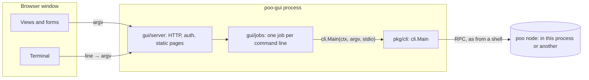

# The GUI

## Summary

The GUI (`poo-gui`) is a visual way to use the same headless node and the
same `poo` commands. It has no logic of its own. The headless code is the
source, and the GUI is built on top of it:

- Everything the GUI does, it does by running a `poo` command line through
  `cli.Main`, the function the `poo` binary runs. A button builds a command
  line, and a view runs a command and renders what it prints. Each view and
  form shows the command it runs, so the user can copy it to a shell.
- The GUI has a terminal that is the headless tool. A line typed there goes
  to `cli.Main` exactly as the same line typed after `poo` in a shell would.
  Anything the views do not cover yet is one line away.
- The GUI is its own Go module under `gui/`. It may import only the
  standard library and `pkg/cli`, and a test enforces that. The core module
  cannot import the GUI at all. Separating the GUI into its own repository
  later means changing one `replace` line into a version requirement, and
  the GUI still pulls everything from the headless source.
- The GUI is a local web app: one Go binary that serves pages on a loopback
  address and opens them in the system browser, or in a browser app window
  with `-app`. It needs no CGO, no native toolkit and no JavaScript build
  step, so it builds for every platform the headless tool builds for.
- The terminal splits a line exactly as the platform's shell would, or
  refuses it. A browser signs in through a one-time sign-in address. A
  passphrase or seed is masked exactly when `poo` reads one, because the
  core tells the GUI (cli.Stdio.Secret, D101). The GUI Red team's
  findings GUI-001 to GUI-005 (security/gui/findings/) led to these rules.
- `poo-gui -view-only` runs every command in the core's view-only mode
  (D101): reads use the node's view token and anything that changes
  something is refused by `poo` itself. The GUI adds only a "view only"
  badge.

Decisions D85 to D89 record these choices.

## TLDR

`poo-gui` is a window onto `poo`. Each click runs a `poo` command, the
terminal tab is `poo`, and the code makes it impossible for the GUI to do
anything `poo` can't.

## Goals

These come from the owner's requirements:

1. **One source of truth.** The headless tool is the source. The GUI uses
   the headless code exactly, so the two cannot behave differently. The
   only difference is how the user interacts with it.
2. **A terminal in the GUI.** It works identically to the headless tool.
   When a feature is too much to put in a form, the terminal covers it.
3. **Separable.** The GUI may move to its own repository later, but it
   always links to and pulls from the headless source.
4. **Downloader.** A future downloader ships the headless source and
   binary, plus the GUI as an option.
5. **Cross-platform.** Linux, macOS and Windows, on the platforms the
   release already builds for.

## Architecture

Here is how a request flows:

1. A view, a form or the terminal produces an argv, which is a list of
   strings such as `["status", "-root", "/home/a/.poo"]`. The terminal gets
   its argv by splitting the typed line the way the platform's shell would
   (see [The terminal's grammar](#the-terminals-grammar)). A leading `poo`
   is dropped, so both `status` and `poo status` work.
2. The server starts a **job**, which is one run of `cli.Main` with its own
   context, its own input and its own output buffer.
3. The browser follows the job's output as a stream of events: output
   chunks, then an exit code. Views that show data run a command whose
   output is JSON and render it. The terminal prints the output as it
   arrives.
4. The browser can send a line to the job's input, for example a
   passphrase prompt, end the job's input, or cancel the job. Ending the
   input does what Ctrl-D does in a shell: the command reads what was
   sent, then the end. The terminal binds Ctrl-D to it, and so do its End
   input button and a form's "Send and end input", which a command that
   reads a paste to its end needs (`poo submit entry -f -`). Cancelling does
   what Ctrl-C does in a shell, and the terminal binds Ctrl-C and Stop to
   it. A cancelled job's read fails. It is never an end of input, so a
   command never acts on what was sent before Stop (GUI-021).

The node itself is a job too. "Start node" runs `poo node` in the GUI
process, and closing the GUI (Ctrl-C, SIGTERM, or closing the terminal it
was started from; see Signals below) cancels it and every other job cleanly. If a node is already
running, for example as a service, the client commands find it through
its data directory, the same way they do from a shell. The GUI does not
need to know which case it is in.

### Signals

Ctrl-C (SIGINT) and SIGTERM always stop poo-gui through its cancel path:
every job is interrupted as Cancel would interrupt it, so a followed
`grind run` stops the node's job and a hosted `poo node` shuts down,
before poo-gui exits 0. SIGHUP depends on how poo-gui was started
(GUI-010, GUI-011):

| Started | SIGHUP |
| --- | --- |
| From a terminal (standard input is a terminal) | The terminal closed: poo-gui stops, as with SIGTERM |
| With SIGHUP ignored, as `nohup poo-gui` does | Stays ignored: poo-gui outlives the session it was started from |
| Without a terminal, for example by a service manager | A reload, as for `poo node`: poo-gui keeps running, and a node it hosts reloads its node policy |

A GUI-hosted node can also be reloaded with `poo reload`, from the
terminal or a shell, whichever way poo-gui was started. Windows sends no
SIGHUP. Headless `poo node` also reloads on SIGHUP.

### Views

Each view is a set of panels and forms. A panel runs one command when it
opens (some refresh on a timer) and renders its output. JSON becomes
tables and lists, with every whole number shown digit for digit even
above 2^53 (GUI-GREEN-055), and any other output is shown exactly as
printed. A form
builds one command line from its fields. Its preview updates as you type,
and Run starts that exact line. Run stays off while that job runs, so a
prompt it shows is never replaced by a second job. Every panel and form shows its command,
with a button that runs it in the terminal.

| View | Commands |
| --- | --- |
| Getting started | First steps, each a command line run in the terminal |
| Node | `node` (start and stop it in the GUI), `status`, `follow` (with `-replace`), `unfollow`, `reload`, `init`, `series followed` (the Followed series and Variable series panels), `series add-release` (a path or a picked file) |
| Watch | `watch` with the filter flags: live events, newest first, with pause, counts and each event in full. It keeps running when you switch views, and its tab shows a dot; Stop ends it |
| Work | `grind devices`, `grind jobs`, `grind run` followed live (the plan `poo` picked, the rate, each layer or entry found; Stop interrupts it), `grind start`, `grind stop`, `grind bench`, and the schedule: `grind schedule` as a table with Remove on each job (one schedule change at a time: Remove, Add and Set are off while one runs and until the table is read again), `grind schedule add` and `grind schedule set` (device, threads, layer floor and rate). It keeps running when you switch views, and a reload takes a running job up again with its Stop |
| Explore | `pools`, `ledger` (page by page), `pending`, `unspent`, `tx`, `address`, with the same filter flags |
| Pools and payments | `status`, `holdings`, `payment`, `build` (with `-parent`), `claim -parent` (a rival claim to grind; the seed in the masked field), `work` (with `-bytes`), `submit` (hex or `-f`) |
| Wallet | `wallet balance`, `addresses`, `address`, `pay`, `request`, `receive`, `status`, `watch`, `claim`, `create` |
| Peers | `peers -counts` (the timed panel), `peers` (and its filters), `peer ACTION` (with `add`, `remove`, `label`, `connect`), `tracking` (`-blocked`, `-timed-out`), `chases`, `peers export` and `peers import` (a preview, then Apply with `-if-digest`) |
| Node policies | `settings export`, `settings import` (the same preview and Apply), `policy list`, `use`, `archive`, `unarchive`, `delete`, `policy export` (printed, with Save as file, or `-out`), `policy import` (a preview of the plan, defences first, with `-settings` and `-full`; then Apply with `-if-digest`; a path or a file picked in the browser, sent as `-`), `policy limits` (each settable limit's range, default and value) and Set limits (`-set NAME=VALUE`) |
| Series and keys | `crypto`, `keygen`, `series new` (with `-max-witness` and `-any-ceiling`; fixed, or variable with `-issuer`, `-part-size` and `-max-parts`; Save as file), `series info`, `series sign` (`-alg`), `series parts`, `series release` (a part, permanent, `-alg`; or `-check` a release file) |
| Jobs | Every command run, its output, stop, run again |
| Settings | `-root` and `-policy`, which views add to their commands |
| Terminal | Anything, typed |

When a view's panels need a running node and none answers, the view shows
one note saying so, with a link to the Node view, and each such panel
folds its error behind "Show the error". The error and its next step are
unchanged, and the note comes only from those commands' own results.
Transaction ids and addresses in results link to Explore, which runs
`poo tx` or `poo address` on them.

Each view is one file in `gui/web/static/views/`, an object `{ id, title,
mount }` built from the panel and form helpers in
`gui/web/static/views.js`. `views/index.js` lists them in navigation
order. The navigation, the narrow-window menu and the e2e checks that walk
every view read that one list (GUI-GREEN-044).

When a running command reads input, such as a passphrase prompt, the view
shows an input field next to it. The field is masked when, and only when,
`poo` is reading a passphrase or seed: the core reads every secret through
`cli.Stdio.Secret` (D101), and the job's state says so. Show unmasks it on
request. The GUI never guesses from the output. Actions that move funds or delete something ask for
confirmation first, and the confirmation shows the command line. The
terminal adds no flags: what you type is what runs.

### What the GUI may contain

The GUI may contain:

- Layout, navigation, forms and rendering of command output.
- Building an argv from form fields. The command validates the argv, not
  the form, so a form can never accept something the command would refuse.
- Splitting a typed line into an argv.

The GUI may not contain anything that decides what is valid, signs,
computes weights or balances, reads node files, or talks to the node's RPC
itself. Any of that would be a second implementation. If a view needs data
that no command prints, the fix is a new command or flag in `pkg/cli`,
which the headless tool then has too.

The rule is enforced in code. `gui/imports_test.go` fails if any GUI
package imports a package from the core module other than `pkg/cli`.

### The terminal's grammar

The terminal splits a typed line into an argv exactly as the shell that
runs `poo` on that platform would, or refuses the line. It never gives a
line a meaning the shell would not give it. `gui/shell` holds both
grammars, and table tests pin them.

- **POSIX (Linux, macOS), as `sh` splits a line.** Spaces and tabs
  separate words. `'...'` is literal. Inside `"..."`, a backslash escapes
  only `$`, `` ` ``, `"` and `\`. Outside quotes, a backslash escapes any
  character, so `C:\new` is `C:new`, as in a shell. Quote a Windows path,
  as in `'C:\Users\a'`. A `#` at the start of a word begins a comment.
- **Windows, as `cmd.exe` passes a line to `poo.exe`.** Spaces and tabs
  separate words. `"..."` groups, and `""` inside quotes is a quote.
  Backslashes are literal except before a quote, so `C:\Users\a` works
  unquoted. Single quotes are ordinary characters, as they are in `cmd`.
- **Refused.** A real shell would run anything that is not a single poo
  command, or would expand it first, so the terminal refuses it with an
  error that says to quote it. On POSIX that is unquoted `| & ; < > ( ) $`,
  `` ` ``, `* ? [`, a leading `~`, and `$` or `` ` `` inside `"..."`. On
  Windows it is unquoted `& | < > ^`. A line holding CR or LF is refused
  too, because a shell would end the command there.
- **Not modeled.** Some features belong to interactive shells and not to
  `sh`, such as bash's `!` history and `{a,b}` brace expansion and
  PowerShell's own quoting. Those characters pass to `poo` literally.
- **One convenience.** A leading `poo` word is dropped, because the prompt
  already reads `poo`. In a shell, `poo` followed by a second `poo` would
  be an unknown command anyway.

Ctrl-D, while a command runs, sends any text on the line, as a shell
does. On an empty line it ends the command's input.

Clearing the screen is the Clear button and Ctrl-L, which are display
controls. `clear` typed as a line goes to `poo` like any other line, as
typing `clear` after `poo` would in a shell. `GET /api/grammar` tells the page which
grammar the server uses, so the command lines that views show split back
into the same argv. A test checks that the page's quoting matches
`shell.Quote`.

### Same output, byte for byte

`gui/jobs` gives `cli.Main` an output writer, an input reader, a secret
reader and, with `-view-only`, the view-only switch, and nothing else. The
secret reader behaves as the headless terminal does: the prompt goes to
standard error and the typed line is not echoed. A test runs a set of commands both directly through
`cli.Main` and through the GUI's HTTP API, and requires identical bytes
and exit codes.

### Commands that stream

Long-running commands, such as `poo node` and `poo watch`, work the same
way. A job streams their output while they run. Streaming commands print
one JSON object per line, so a view can render each event as it arrives
(docs/modules/watch.md).

The page reads a job's output as server-sent events. Adjacent writes of
one stream are joined into one `chunk` event of at most 64 KiB, which
keeps the bytes exactly as written (ORANGE-002). Each `chunk` carries
`seq` (its first write) and `next` (the write after its last), and its
event id is `next`. A browser that reconnects sends `Last-Event-ID`, and
a view that left and comes back follows again with `?from=next`
(GUI-008), so output is neither repeated nor lost. Long output is held in
bounded scrollback (1 MiB) and drawn once per frame (ORANGE-001,
ORANGE-003). `gui/perf` has the kit Orange measured with.

### Security

A process that can run `poo` commands can spend from a wallet, so the GUI
server is locked down:

- **Loopback only.** The server listens on `127.0.0.1`. It refuses to
  listen on any other address. With no `-listen` it comes back on the port
  it used last, kept as a bare number in `poo-gui/last-port` under the
  user's config directory, and takes any free port when that one is busy.
  The browser keeps the GUI's saved settings (node policy, wallet file,
  theme, terminal history) per origin, port included, so a stable port
  keeps them across restarts (GUI White G1). The token still changes on
  every start. A second poo-gui started while one runs finds the port busy, takes
  another and keeps that one, so the next start comes back there. To run
  two at once and keep each one's settings, give each its own `-listen`.
- **One-time sign-in addresses.** A browser signs in by opening
  `http://127.0.0.1:PORT/?t=TOKEN`, where the token is 32 random bytes. The
  first visit spends the token. It sets a session cookie that is a
  separate random value, not derived from the token, and is HttpOnly and
  SameSite=Strict. Then it redirects to a clean URL. Every request needs
  that cookie. A token works once, and only within a short time: one
  minute for the address poo-gui opens itself, and five minutes for one it
  prints. So an address left in a process list (the browser's arguments),
  in the browser's history or in a log signs nobody in. By default poo-gui
  opens the browser and does not print the token it used. With `-no-open`
  it prints an address. Press Enter in poo-gui's window for a new address,
  for example to sign in a second browser or after one expires. The
  server keeps only hashes of tokens and cookies.
- **Residual exposure.** The address poo-gui opens is in the browser's
  process arguments until the browser spends it, which is usually under a
  second. On a host shared with users you do not trust, use `-no-open`
  and paste the address yourself, so no token ever appears in a process
  list.
- **Host and Origin checks.** Requests whose Host is not the loopback
  address and port are refused, which blocks DNS rebinding. API calls that
  change something must be POSTs that carry the `X-Poo-GUI` header and, if
  present, a matching Origin. A cross-site page cannot send that header
  without a preflight, and the server answers no preflight.
- **A strict Content-Security-Policy.** Only the GUI's own scripts and
  styles run, and no third-party code is loaded.
- **Secrets stay out of the scrollback.** When `poo` reads a passphrase
  or seed, it asks through `cli.Stdio.Secret` (D101), so the GUI knows
  exactly which line is a secret. That line is masked and not echoed,
  unless the user clicks Show typing. Other input shows as typed, as in a
  shell. The GUI does not guess from a command's output whether a prompt
  reads a secret, because a guess can fail open. Before D101 every line
  sent to a running command was masked (GUI-003).
- **Secrets on the command line.** A seed can also be passed as an
  argument: `wallet create -restore HEX`, `keygen -seed HEX`. The GUI runs
  `poo` in its own process, so no other process sees that argument. It
  keeps the seed out of two places that last (GUI-006). The terminal saves
  its history in the browser's storage, and it does not save a line that
  holds a secret flag (`shell.SecretFlags`: `-restore`, `-seed`, except
  `sim -seed`), or a line that starts with a space, as a shell with
  `HISTCONTROL=ignorespace` does. A secret flag whose value is `-`
  (`wallet create -restore -`) holds no secret and is saved. No form puts
  a seed on its line: Make a key runs `keygen -seed-file -`, which reads
  the seed from the masked field (D98, GUI-GREEN-047). Up-arrow still
  recalls such a line for the rest of the session, and Forget history clears what is saved. Jobs
  and `GET /api/jobs` show the flag's value as `<hidden>` and do not offer
  the line to run again. The terminal still echoes the line as typed, as a
  shell does, and a form's preview shows it.
- **Secrets in output.** `wallet seed` and `keygen` print a seed
  (`shell.SecretOutput`, until the core declares it as
  `cli.SecretOutput`). Once such a job ends, its output goes to the first
  reader that reads it to the end, such as the terminal or the form that
  ran it, and is then dropped. If no one reads it, it is dropped after a
  minute. Jobs says "output not kept (it held a secret)", and the event
  stream answers a later read, including `?from=0` and `Last-Event-ID`,
  with `dropped` and `withheld: true`. A result box shows a `seed` field,
  or the whole text output of such a command, hidden until Show, and it
  never copies it on click (GUI-009).
- **View-only mode.** `poo-gui -view-only` passes the core's view-only
  switch to every job, so commands dial the node with `rpc.view-token`
  and the core refuses every command not in its read table. The GUI has
  no list of its own; it only shows a badge. Write forms still render,
  and running one prints the core's refusal, as `poo -view-only` would.
  Passphrases are never stored, and a job's unread input is discarded
  when the job ends.
- **Authority.** The session cookie, like a sign-in address before it is
  spent, gives full control of the node. Whoever holds it can run any
  `poo` command, including spending from the wallet and changing its
  passphrase, just as a shell can. Treat a printed sign-in address like
  the wallet passphrase, and do not paste it into tickets or chats. View
  forms that move funds or delete something ask for confirmation, but
  that is a guard against a stray click, not a security boundary. The
  terminal, like a shell, asks nothing.

### Limits

- Job output is kept in a bounded buffer of 4 MiB per job. When a long
  stream runs past that, the oldest output is dropped and the view is told.
- At most 64 jobs are kept, and finished jobs keep at most 64 MiB of
  output in total. Finished jobs are dropped oldest first.
- At most 16 jobs run at once. Starting another is refused (HTTP 503)
  until one ends.
- At most 32 event streams are open at once.
- The Watch view shows at most 1000 events. While it is paused it holds
  at most the newest 1000 more and says how many it dropped. It keeps the
  last 64 KiB of error text and drops a line longer than 1 MiB (GUI-007).
- A watch keeps running when you leave the Watch view, but the page
  closes its event stream while the view is away and follows again from
  the next output sequence number (`?from=`) on return. The browser holds
  no stream for it in the background, and nothing is missed unless the
  server dropped output past its 4 MiB, which the view reports (GUI-008).

## Technology choice (D85)

| Option | Cross-platform | Build | Terminal | Verdict |
| --- | --- | --- | --- | --- |
| **Local web app, Go server and browser UI** | Everywhere Go builds | Pure Go, no CGO, no JS build | Line terminal in the page | **Chosen** |
| Wails (Go and native webview) | Good | CGO, webkit2gtk on Linux, Node toolchain | Same as web | Possible later as a shell around the same server |
| Fyne (pure Go widgets) | Good | CGO and OpenGL | Must write a terminal widget | Harder to test, custom look |
| Electron or Tauri | Good | Node or Rust toolchain, large bundles | xterm.js | Adds a second language and toolchain |
| A TUI (terminal UI) | Everywhere | Pure Go | Native | Not the visual, beginner-friendly layer asked for |

The local web app wins on three points:

- It keeps the release reproducible with only the Go toolchain (D78).
- It runs on all seven release platforms.
- CI can test it end to end with a headless browser.

A native window remains possible. A webview shell such as Wails can wrap
the same server later without changing any view. Until then, `-app`
opens a Chromium-family browser in app mode, which gives a window with no
browser chrome.

The page is plain HTML, CSS and JavaScript, embedded in the binary with
`embed`. There are no frameworks, no npm and no CDN. This keeps the CSP
strict, keeps the supply chain to the Go module graph, and means anyone
can read the GUI's code in place.

## Packaging and the downloader (D88)

- `poo` stays the headless binary and never contains GUI code.
- `poo-gui` contains `pkg/cli`, so it is the headless tool plus the GUI.
  `poo-gui poo ARGS...` runs a command exactly as `poo ARGS...` would, for
  scripts and for checking that the two agree.
- Release archives ship `poo` always, and `poo-gui` in a separate archive
  per platform: `poo-gui-VERSION-OS-ARCH.tar.gz` (`.zip` on Windows),
  listed in `SHA256SUMS` (`scripts/release.sh VERSION`). From a checkout,
  `go -C gui build -o poo-gui ./cmd/poo-gui` builds the same program.
  `go install github.com/JogginTheNoggin/crypto-mint-net/gui/cmd/poo-gui@TAG` does not work while `gui/go.mod`
  replaces the core module with this tree, so build from a checkout of the
  tag. The downloader offers the headless tool, with the GUI as
  an option. Both come from one source tree at one version.
- If the GUI moves to its own repository, its `go.mod` requires the core
  module at a released version, and the downloader pairs the two at the
  same version.

## Plan

The GUI is built in stacked pull requests:

| PR | Content |
| --- | --- |
| G1 (#10) | `pkg/cli`: the commands as a library, behind `cli.Main` (D84) |
| G2 | The `gui` module: server, security, job runner, terminal, the import rule and identity tests, and CI |
| G3 (this) | Views: node (start and stop, status), pools, peers, tracking, chases, node policies, series and crypto, and wallet (create, addresses, balance, pay, request, receive, status) |
| G4 (done) | Watch and filter views on the node thread's `poo watch` and filter flags: live transactions, a series' or policy's ledger, and pending items |
| G5 (done) | Packaging: `poo-gui` in the release script and the tag workflow |
