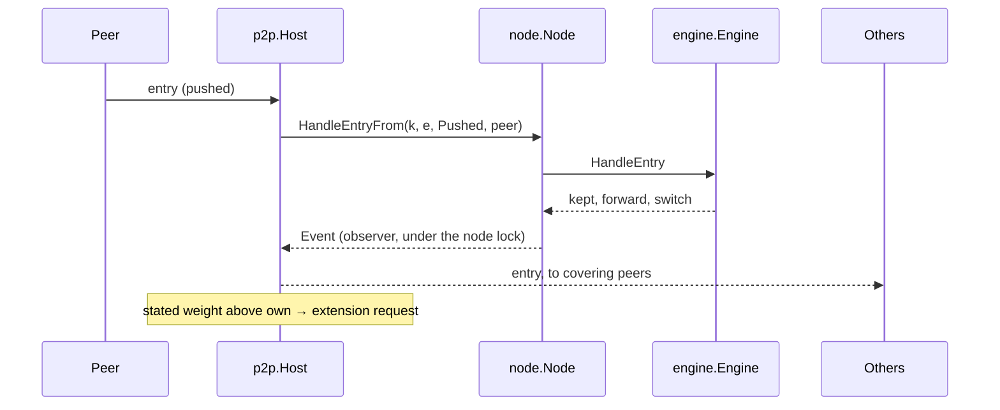

# pkg/p2p

## Summary

The network side of a full node. A `Host` listens for peers, keeps the
peers the node policy lists connected, forwards every item the node keeps
to the peers that cover its pool, serves ledger data requests from the
active ledger, and catches up when a peer has a heavier ledger. It follows
the design's "Forwarding" and "Ledger Data" documents; the byte forms are
in [../protocol/wire.md](../protocol/wire.md). Every item still goes
through the node and its engine, so validity, selection and switching are
decided exactly as for local items.

## How it fits

## Files

| File | Holds |
| --- | --- |
| `host.go` | `Config`, `DefaultConfig`, `Host`, `New`, `Run`, `Connect`, `Peers`, dialling and the regular check |
| `peer.go` | the hello, a peer's read and write loops, its bounded send queue, and `ask` (one request and its chunks) |
| `forward.go` | `onKept` (forwarding and notices) and pushed items |
| `serve.go` | answering requests from the active ledger within limits |
| `chase.go` | catching up: full ledger, extensions, finding the split, layers |
| `policy.go` | `FromPolicy`: settings from the node policy |

## Rules it keeps

- Forward only what the node kept, only to covering peers, never back to
  the sender, never requested or stored data. Notices instead after a
  switch that forwarding does not show.
- Stated weight only starts a request. Switching happens in the engine,
  on computed weight.
- Ask only from an entry held or a hash the same peer sent. Entries of a
  reply must chain from the request's starting point.
- Serve only followed pools, only from the active ledger, within the
  asker's limits capped by `ServeEntries` / `ServeHashes`, in chunks of
  whole items, with the server's own stated weight.

## Concurrency

Lock order is node, then engine, then host. Observers run under the node
lock, so `onKept` only queues messages; a peer's queue is bounded and a
peer that falls behind is disconnected. The host never calls the node
while holding its own lock. One catch-up runs per pool at a time; a reason
to ask that arrives during one starts another when it ends (at most 8 in a
row).

## Tests

`p2p_test.go` runs nodes over loopback TCP: forwarding along a line of
nodes, a late node fetching the full ledger in several replies, a deep fork
found through hash-chain paging and converging on the heavier side,
requested data reaching a third node only through a notice and its own
requests, extra layers on shared entries, regular checks without notices,
self and duplicate connections. `serve_test.go` drives a node by hand over
a raw connection and checks each request's replies, chunking, limits and
more markers, refusals of repeated and stale requests, and that malformed
messages and invalid entries disconnect.

## Extending

Peer discovery and relaying (milestone 4) add message types and a peer
source next to `Config.Peers`. Peer ranking and the full chasing rules
(milestone 5) replace the disconnect-on-misbehaviour policy and the choice
of which peer to ask (`anyPeerFor`). Keep new behaviour out of the engine:
the engine stays transport-independent.
