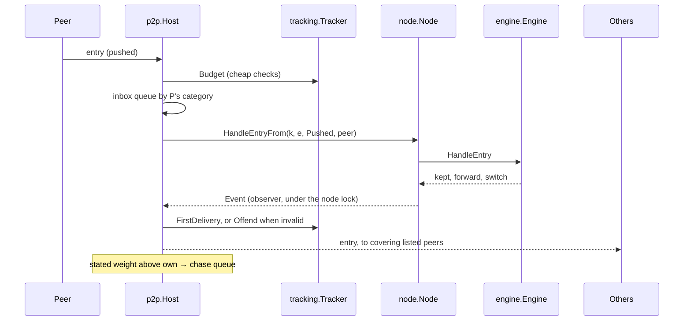

# pkg/p2p

## Summary

The network side of a full node. A `Host` listens for peers, finds and
checks peers for each mint policy it follows, sorts them into **priority**,
**backup** and **candidate** peers by points, forwards every item the node
keeps, serves ledger data requests from the active ledger, and **chases**
heavier stated weights without being misled by them. It records what each
peer does in a tracker (`pkg/tracking`) and acts on offences with flags,
timeouts and blocks. It follows the design's "Forwarding", "Ledger Data",
"Peer Discovery and Management", "Address Registries", "Peer Categories
and Ranking", "Peer Tracking and Telemetry" and "Chasing Heavier Ledgers";
the byte forms are in [../protocol/wire.md](../protocol/wire.md). Every
item still goes through the node and its engine, so validity, selection
and switching are decided exactly as for local items.

## How it fits

## Files

| File | Holds |
| --- | --- |
| `host.go` | `Config`, `DefaultConfig`, `Host`, `New`, `Run`, `Connect`, `Peers`, dialling and the regular check |
| `peer.go` | the hello, a peer's read and write loops and bounded send queue, its standing per mint policy, dispatch with budgets, offences and their actions, and `ask` (one request and its chunks) |
| `inbox.go` | the queues by category and the worker that empties them |
| `rank.go` | placing a newly verified peer, reviews, archiving inactive peers, choosing whom to ask |
| `forward.go` | `onKept` (forwarding and notices) and pushed items |
| `serve.go` | answering requests from the active ledger within limits, and their cost |
| `chase.go` | running chases: confirming, finding the common entry, checking the work, fetching the branch |
| `discovery.go` | follow requests (asking, answering, relaying with return paths), peer lists and missing chunks, pings, dropped policies, the connection manager, broadcasts and registries |
| `admin.go` | the owner's controls: `TimeOut`, `Block`, `Unblock`, `DeletePeer`, `SetPeerTemplate`, `ClearPeer`, `TrackerReport`, `Tracked` |
| `policy.go` | `FromPolicy`: settings from the node policy |

## Finding and ranking peers

1. After the hello, each side asks the other, with a direct follow request
   for each of its mint policies, whether it follows it. A yes or partial
   yes verifies the connection for those policies. It is then **placed**
   (`peers.Slots.Place`): priority if a priority slot is free and its
   flags and the spread rules allow, else backup if a backup slot is free,
   else candidate. A peer returning from a timeout gets back what it held,
   but never more (and only backup with `StrictReturn`).
2. An **outbound** connection that is verified but finds no slot is closed
   and the address retried later. An **inbound** one stays as a candidate
   for what it was verified for. An inbound connection verified for
   nothing stays **unlisted** (a wallet or light node), within
   `UnlistedConns` (8; the least active goes first), is served, and never
   forwarded to.
3. A **review** (`Review`, every 10 minutes) archives priority and backup
   peers not heard from for 30 minutes, then applies `peers.Slots.Review`:
   flags bar priority, free slots fill by points, and a backup swaps with
   the lowest priority peer when its fair points (pings, round trips,
   first deliveries) beat it by the margin.
4. The connection manager (`Manage`, every 30 seconds) dials candidates
   while a policy has fewer listed peers than its slots, then the archive,
   then asks a peer for its peer list, broadcasts a follow request and
   loads the registries. Everything learned is a candidate; a blocked or
   timed-out address is never dialled or accepted.
5. Pings: every 2 minutes to priority peers, every 6 to backups; 3 missed
   in a row archive the peering. Candidates and unlisted nodes are not
   pinged.

## Handling what arrives

Every message passes cheap checks first, in `dispatch`: replies go to the
waiting request; everything else is counted against the sender's
**budget** for its kind (dropped and flagged when over), then queued by
the sender's best category. A pushed entry also spends, before it is
handled, the entries the node must revert to check it against the state
after its parent (`Engine.EntryCost`) from the sender's `revert` budget;
over it the entry is dropped (RED-011, D111). Entries the node asked for
are not charged. The **inbox** worker takes each round 8 from
the priority queue, 4 from backup, 2 from candidate and 1 from unlisted,
so busy unlisted senders cannot starve peers and nothing waits forever.
Each queue holds 1024; beyond that new messages are dropped.

An offence flags the sender's address (see [tracking.md](tracking.md)):
an invalid pushed entry or layer is a flag; a message that cannot be
decoded is a flag and closes the connection; a provably false branch is a
flag. When the flags reach the timeout or block limit, every connection
from that address closes and new ones are refused until it ends.

## Chasing

A stated weight above this node's own (from a pushed item, a notice, a
reply or a weight request) goes to the chase queue (`pkg/chase`), grouped
with others naming the same branch and ordered by evidence. Pushed items
naming a known-bad hash are ignored. Each chase, from cheap to costly:

1. If this node has caught up meanwhile, stop.
2. A group whose sender is not a priority peer is first put to one
   priority peer, as an extension request from this node's tip; if it
   sees something heavier, the group is corroborated and requeued; if
   not, that is noted as a denial (counted against the priority peer if
   the branch later proves real).
3. Holding nothing of the pool, fetch the sender's whole ledger.
4. Find the common entry: page the sender's hash chain back from its tip,
   at most 16 pages; past that, a priority peer's whole ledger is fetched
   only with `FastCatchUp`. A hash listed twice is a false branch.
5. **Check the work** before any entry: ask for the layers on the hashes
   after the common entry and add their credit, provisionally, until it
   beats the weight of this node's ledger after the common entry
   (`ledger.Pool.WeightTo`). Layers below the minimum strength make the
   branch false; too little work ends the chase with a backoff. The
   provisional layers are never kept, counted or forwarded.
6. Fetch the entries in chain order with extension requests, each checked
   against the hash the sender listed. The engine then decides, on weight
   it computed itself.

Outcomes feed the tracker (chase outcomes, denials, the false-branch
offence) and the queue (backoff, known-bad list). Regular checks
(`CheckEvery`, every minute) ask the priority peers of each pool for their
stated weight.

## Rules it keeps

- A peer is a peer only for what this node verified itself; the hello,
  contacts, peer lists and registries are hints.
- Relay only broadcast follow requests, only as a follower, only to listed
  peers for the policy, below the hop limit; pass replies back as one
  message without peers.
- Forward only what the node kept, only to listed peers, never back to the
  sender, never requested or stored data. Notices instead after a switch
  that forwarding does not show.
- Stated weight only queues a chase. Switching happens in the engine, on
  computed weight; no entry is fetched before the work behind it is
  checked.
- Ask only from an entry held or a hash the same peer sent. Entries of a
  reply must chain from the request's starting point.
- Serve only followed pools, only from the active ledger, within the
  asker's limits capped by `ServeEntries` / `ServeHashes`, in chunks of
  whole items, with the server's own stated weight. A repeated request id
  is refused and counted as a repeat; bytes served and whole-ledger
  requests count against the asker's points.

## Concurrency

Lock order is node, then engine, then host, then peer. The tracker and
the chase queue have their own locks and call nothing back. Observers run
under the node lock, so `onKept` only queues messages; a peer's send
queue is bounded and a peer that falls behind is disconnected. The host
never calls the node while holding its own lock.

## Tests

`discovery_test.go` runs discovery over loopback TCP: relayed broadcasts,
relay and hop limits, peer lists feeding the connection manager,
registries, archiving its own address, pings ending a silent peering,
dropped policies, the answers to follow requests and pings, rate limits,
peer list chunks and follow replies with peers. `p2p_test.go`: forwarding,
catching up with the full ledger, a deep fork converging on the heavier
side, requested data spreading only through notices, extra layers,
regular checks, self connections, unlisted connections, and inbound
connections kept out of the outbound slots (D75). `rank_test.go`:
placing peers in slots, closing an outbound peer with no slot, a review
swapping a backup with a priority peer by points, and blocked addresses
refused both ways. `chase_test.go` drives a chase against a hand-driven
peer: a made-up branch is caught by its missing work before any entry is
asked for and its sender backed off, and a self-contradicting one is
flagged and its hash marked bad. `serve_test.go` checks each request's
replies, limits, refusals of repeated and stale requests, malformed
messages, invalid entries leading to a timeout, and the cost of serving.

## Extending

Keep new behaviour out of the engine: the engine stays
transport-independent. A new offence goes in `pkg/tracking` and is raised
here through `Offend` and `act`; a new chase step goes in `runChase`,
keeping the order from cheap to costly.
