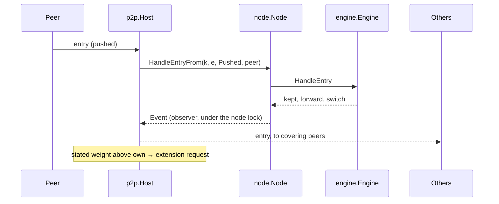

# pkg/p2p

## Summary

The network side of a full node. A `Host` listens for peers, finds and
checks peers for each mint policy it follows, forwards every item the node
keeps to the peers verified for its pool, serves ledger data requests from
the active ledger, and catches up when a peer has a heavier ledger. It
follows the design's "Forwarding", "Ledger Data", "Peer Discovery and
Management" and "Address Registries" documents; the byte forms are
in [../protocol/wire.md](../protocol/wire.md). Every item still goes
through the node and its engine, so validity, selection and switching are
decided exactly as for local items.

## How it fits

## Files

| File | Holds |
| --- | --- |
| `host.go` | `Config`, `DefaultConfig`, `Host`, `New`, `Run`, `Connect`, `Peers`, dialling and the regular check |
| `peer.go` | the hello, a peer's read and write loops, its bounded send queue, and `ask` (one request and its chunks) |
| `forward.go` | `onKept` (forwarding and notices) and pushed items |
| `serve.go` | answering requests from the active ledger within limits |
| `chase.go` | catching up: full ledger, extensions, finding the split, layers |
| `discovery.go` | follow requests (asking, answering, relaying with return paths), peer lists and missing chunks, pings, dropped policies, the connection manager, broadcasts and registries |
| `policy.go` | `FromPolicy`: settings from the node policy |

## Finding peers

1. After the hello, each side asks the other, with a direct follow request
   for each of its mint policies, whether it follows it. A yes or partial
   yes makes the connection a peer for those policies (subject to
   `VerifiedPerRange`); a connection verified for nothing is closed. Only
   then does the node forward to it, ask it for ledger data and catch up.
2. The connection manager (`Manage`, every 30 seconds) counts verified
   peers per policy. Below `PeersPerPolicy` it dials candidates from the
   book (`peers.Book.Pick`, within `MaxOutbound`), then the archive. When
   still short it asks a peer for its peer list and broadcasts a follow
   request (at most every `BroadcastEvery`), and loads the registries (at
   most every `RegistryEvery`). Everything learned is a candidate.
3. Pings (`PingEvery`) keep peerings current; `MaxMisses` silences end one.
4. Listed peers (`Config.Peers`) are always redialled with backoff,
   whatever the manager does.

The node offers its own contact details only when `Advertise` is set.

## Rules it keeps

- A peer is a peer only for what this node verified itself; the hello,
  contacts, peer lists and registries are hints.
- Relay only broadcast follow requests, only as a follower, only to peers
  for the policy, below the hop limit; pass replies back as one message
  without peers.
- Forward only what the node kept, only to verified peers, never back to
  the sender, never requested or stored data. Notices instead after a
  switch that forwarding does not show.
- Stated weight only starts a request. Switching happens in the engine,
  on computed weight.
- Ask only from an entry held or a hash the same peer sent. Entries of a
  reply must chain from the request's starting point.
- Serve only followed pools, only from the active ledger, within the
  asker's limits capped by `ServeEntries` / `ServeHashes`, in chunks of
  whole items, with the server's own stated weight.

## Concurrency

Lock order is node, then engine, then host. Observers run under the node
lock, so `onKept` only queues messages; a peer's queue is bounded and a
peer that falls behind is disconnected. The host never calls the node
while holding its own lock. One catch-up runs per pool at a time; a reason
to ask that arrives during one starts another when it ends (at most 8 in a
row).

## Tests

`discovery_test.go` runs discovery over loopback TCP: a broadcast relayed
along a line of nodes and the asker connecting to the repliers, relay and
hop limits, peer lists feeding the connection manager, bootstrapping from
a registry (directly and from the manager), a node archiving its own
address, pings ending a silent peering, dropped policies, the answers to
follow requests and pings for full, partial and no coverage, rate limits,
peer list chunks and missing chunks, and follow replies with peers.
`p2p_test.go` runs nodes over loopback TCP: forwarding along a line of
nodes, a late node fetching the full ledger in several replies, a deep fork
found through hash-chain paging and converging on the heavier side,
requested data reaching a third node only through a notice and its own
requests, extra layers on shared entries, regular checks without notices,
self and duplicate connections. `serve_test.go` drives a node by hand over
a raw connection and checks each request's replies, chunking, limits and
more markers, refusals of repeated and stale requests, and that malformed
messages and invalid entries disconnect.

## Extending

Peer ranking and the full chasing rules (milestone 5) replace the
disconnect-on-misbehaviour policy, the choice of which peer to ask
(`anyPeerFor`, which prefers outbound peers) and which candidates to dial
(`peers.Book.Pick`). Keep new behaviour out of the engine:
the engine stays transport-independent.
