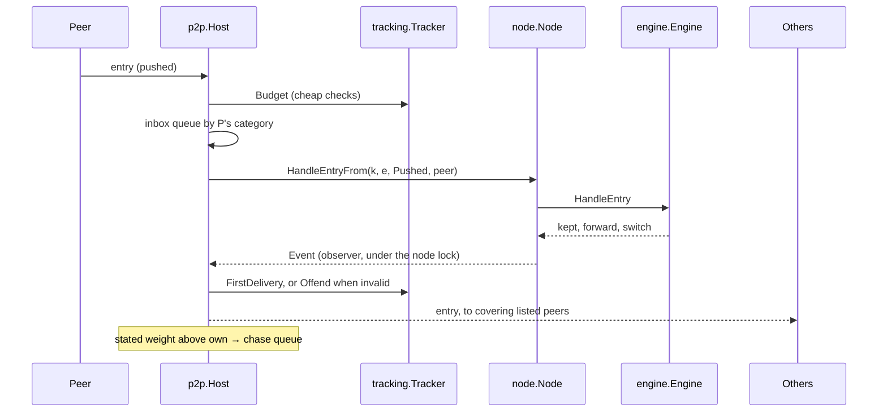

# pkg/p2p

## Summary

The network side of a full node. A `Host` listens for peers, finds and
checks peers for each mint policy it follows, sorts them into **priority**,
**backup** and **candidate** peers by points, forwards every item the node
keeps, serves ledger data requests from the active ledger, and **chases**
heavier stated weights without being misled by them. It records what each
peer does in a tracker (`pkg/tracking`) and acts on offences with flags,
timeouts and blocks. It follows the design's "Forwarding", "Ledger Data",
"Peer Discovery and Management", "Address Registries", "Peer Categories
and Ranking", "Peer Tracking and Telemetry" and "Chasing Heavier Ledgers";
the byte forms are in [../protocol/wire.md](../protocol/wire.md). Every
item still goes through the node and its engine, so validity, selection
and switching are decided exactly as for local items.

## How it fits

## Files

| File | Holds |
| --- | --- |
| `host.go` | `Config`, `DefaultConfig`, `Host`, `New`, `Run`, `Connect`, `Peers`, dialling and the regular check |
| `peer.go` | the hello, a peer's read and write loops and bounded send queue, its standing per mint policy, dispatch with budgets, offences and their actions, and `ask` (one request and its chunks) |
| `inbox.go` | the queues by category and the worker that empties them |
| `rank.go` | placing a newly verified peer, reviews, archiving inactive peers, choosing whom to ask |
| `forward.go` | `onKept` (forwarding and notices) and pushed items |
| `serve.go` | answering requests from the active ledger within limits, and their cost |
| `chase.go` | running chases: confirming, finding the common entry, checking the work, fetching the branch |
| `discovery.go` | follow requests (asking, answering, relaying with return paths), peer lists and missing chunks, pings, dropped policies, the connection manager, broadcasts and registries |
| `admin.go` | the owner's controls: `TimeOut`, `Block`, `Unblock`, `DeletePeer`, `SetPeerTemplate`, `ClearPeer`, `TrackerReport`, `Tracked` |
| `policy.go` | `FromPolicy`: settings from the node policy |

## Finding and ranking peers

1. After the hello, each side asks the other, with a direct follow request
   for each of its mint policies, whether it follows it. A yes or partial
   yes verifies the connection for those policies. It is then **placed**
   (`peers.Slots.Place`): priority if a priority slot is free and its
   flags and the spread rules allow, else backup if a backup slot is free,
   else candidate. A peer returning from a timeout gets back what it held,
   but never more (and only backup with `StrictReturn`).
2. An **outbound** connection that is verified but finds no slot is closed
   and the address retried later. An **inbound** one stays as a candidate
   for what it was verified for. An inbound connection verified for
   nothing stays **unlisted** (a wallet or light node), within
   `UnlistedConns` (8; the least active goes first), is served, and never
   forwarded to.
3. A **review** (`Review`, every 10 minutes) archives priority and backup
   peers not heard from for 30 minutes, then applies `peers.Slots.Review`:
   flags bar priority, free slots fill by points, and a backup swaps with
   the lowest priority peer when its fair points (pings, round trips,
   first deliveries) beat it by the margin.
4. The connection manager (`Manage`, every 30 seconds) dials candidates
   while a policy has fewer listed peers than its slots, then the archive,
   then asks a peer for its peer list, broadcasts a follow request and
   loads the registries. Everything learned is a candidate; a blocked or
   timed-out address is never dialled or accepted.
5. Pings: every 2 minutes to priority peers, every 6 to backups; 3 missed
   in a row archive the peering. Candidates and unlisted nodes are not
   pinged.

## Handling what arrives

Every message passes cheap checks first, in `dispatch`: replies go to the
waiting request; everything else is counted against the sender's
**budget** for its kind (dropped and flagged when over), then queued by
the sender's best category. A pushed entry also spends, before it is
handled, what the node must revert and apply to check it against the state
after its parent (`Engine.EntryCost`) from the sender's `revert` budget;
over it the entry is dropped (RED-011, D111). Entries a chase takes in
pay the same, and an empty budget ends the fetch (RED-012, D114). The **inbox** worker takes each round 8 from
the priority queue, 4 from backup, 2 from candidate and 1 from unlisted,
so busy unlisted senders cannot starve peers and nothing waits forever.
Each queue holds 1024; beyond that new messages are dropped.

An offence flags the sender's address (see [tracking.md](tracking.md)):
an invalid pushed entry or layer is a flag; a message that cannot be
decoded is a flag and closes the connection; a provably false branch is a
flag. When the flags reach the timeout or block limit, every connection
from that address closes and new ones are refused until it ends.

## Chasing

A stated weight above this node's own (from a pushed item, a notice, a
reply or a weight request) goes to the chase queue (`pkg/chase`), grouped
with others naming the same branch and ordered by evidence. Pushed items
naming a known-bad hash are ignored. Each chase, from cheap to costly:

1. If this node has caught up meanwhile, stop.
2. A group whose sender is not a priority peer is first put to one
   priority peer, as an extension request from this node's tip; if it
   sees something heavier, the group is corroborated and requeued; if
   not, that is noted as a denial (counted against the priority peer if
   the branch later proves real).
3. Holding nothing of the pool, first check the work as in step 5 from
   the pool_id (any heavier ledger shows some against this node's none),
   then fetch the sender's whole ledger, charged to its `revert` budget,
   which waits for room rather than refusing (RED-016, D120).
4. Find the common entry: ask for the sender's newest hashes; if none is
   held, halve over this node's own selected ledger, asking whether the
   sender holds the entry at a height (about log₂(height) requests at any
   depth). There is no depth limit (D116). A hash listed twice is a false
   branch.
5. **Check the work** before any entry: page the sender's hashes on from
   the common entry and ask for the layers on them, adding their credit
   provisionally until it beats the weight of this node's ledger after the
   common entry (`ledger.Pool.WeightTo`). Layers below the minimum strength
   make the branch false; too little work ends the chase with a backoff.
   The provisional layers are never kept, counted or forwarded. There is
   no cap on how many are looked at, nor on the hashes paged. Only work is
   held: the page being checked, the hashes that carried layers and the
   entries fetched; a hash with no layers is let go once checked. After
   `WeightlessPages` (64) pages in a row that bring no work the chase
   yields and goes on later from where it stopped, so a listing with no
   work is paced, never refused (RED-015, D120).
6. Fetch the entries in chain order with extension requests, each checked
   against the hash the sender listed, not charged to the revert budget
   (the work was checked); a hash that carried layers in step 5 must be
   the entry sent at its place. An entry larger than `PartsOver` comes in
   parts (`fetchParts`, D117): each part holds at least a byte, the first
   starts with the expected parent, and the parts go to a temporary file in
   `PartsDir` (`poo node` sets it to `parts/` in the data directory and
   empties it of a crash's leftovers on start, GREEN-033), not memory, until the entry is whole; past its slice the
   fetch yields and the next slice goes on from the offset it reached
   (RED-016, D120). Before each part the free space of that disk is
   read; when the part would go into the reserve (the larger of
   `PartsReserve`, 1 GiB by default, and 2% of the disk) the chase yields
   with its parts and goes on from their offset once there is room. It is
   never refused (RED-022, D123). The node answers parts requests from the
   entry and its unsorted layer nonces copied under the engine lock, and
   sorts and encodes them outside it; the item is kept for a minute after
   its last use (up to 256 MiB in all), so a fetch in many requests encodes
   it once (RED-017, RED-020). Before each request the chase checks no ledger
   off the branch and heavier than its work was selected meanwhile. The
   engine then decides, on weight it computed itself.

When the sender's newest hash is held but off the selected ledger, the
node already holds that branch, perhaps without its layers: the chase
walks back through local entries to where the branch leaves the selected
ledger and runs steps 5 and 6 on it. When the newest hash is on the
selected ledger, the sender holds the same entries with more layers, and
the chase asks for the layers on the sender's hashes page by page back
from its tip (`topUpLayers`, Black's B1, D121). An entry with more than
`LayersWhole` layers has them paged (`askLayers`, D121); each page is
counted as it arrives and the paging stops once the work beats the
node's, so no entry's layers are held whole (RED-021, D123). The node
answers layers-from requests by counting the layers under the engine
lock and, unless the order for that count is cached, copying the nonces
unsorted; it hashes and sorts them strongest first outside the lock, and
caches the order under the entry and its layer count (RED-020). When the node's
own ledger outgrows the work counted so far during step 6, the chase goes
back to step 5 and counts more; only a branch counted to its end is not
heavier (C-1). Step 5 moves on only past the entries it counted whole: an
entry it stopped in the middle of keeps its offset, and the ones after it
are asked for again when the chase comes back (Black's C-5, D124). Paging
one entry's layers checks the time slice and the pace before each page
after the first and yields with the entry and its offset kept. It checks
the strongest-first order across pages in constant memory: a page may
start with layers read already, no more of them than the stated total grew
by, and must reach the furthest layer read before going past it; a sender
that repeats, skips or reorders otherwise is false (Black's B3, D124).

A chase runs for at most `ChaseSlice` (2 minutes) and then **yields**
(`chase.Yield`): its sender waits `chase.Config.YieldWait` with no
backoff, and what the chase learned (the common entry, the hashes with work,
the work counted, the last entry fetched) is kept, so the next chase of
the same group and sender goes on from there. Each slice makes at least
one request, so a chase always moves forward. The chase also counts the
requests it sent each sender over `RequestPaceWindow` (a minute) and
yields at `RequestPace` (480), under the 600 a minute peers serve by
default (ORANGE-018). When a second request in a row to a sender goes
unanswered, with no reply from it since either was sent, the chase takes
that as the sender's budget being lower: the pace to that sender becomes
three quarters of what was sent it in the window, for 30 windows from the
last such drop, even with `RequestPace` off, so a sender with a smaller
budget never flags this node often enough to time it out (D133). The
first pace learned this way is a probe, since two requests lost while
little was sent say little about the budget: it doubles each window the
sender replies in and ends at `RequestPace`. Drops again while probing,
or with as much sent as the sender dropped at before, show the budget,
which then holds; drops with less than half of a held pace sent never
lower it (RED-028, D136). Drops while probing show the budget only with
at least seven eighths of what was sent at the first drops; with less,
the probe was holding the chase low itself, so the probe halves (not below
where it began) and goes on rising (RED-034, D139). A request that still times out ends the chase as
`chase.Stalled`: the sender is backed off but kept, and so is the chase's
progress, its parts included, so a slow sender or one with a smaller
budget only delays it (Black's B2, D124; RED-024, D128). A stall after
the chase took something in (entries, layers, parts or counted work) is
`chase.Slowed`: the sender waits the first backoff step and its doubling
starts again, so a steady slow sender is not pushed to an hour between
slices. Kept progress holds nothing for each layer: it remembers which
entries had their layers counted, an entry's layers are told apart within
the reply that carries them, and a many-layers page passes on only the
layers not read before (RED-026, D131). Once its sender has been
disconnected for `ProgressGrace` (2 minutes) a kept progress loses its
parts file and is cut down to its common entry; what it counted is asked
for again if the sender comes back (RED-023, D128; RED-026, D131). A fetch
that finds no room for a whole part on the disk (a byte of room is not
room) asks anyway if some other kept parts file may give way, and takes
room only for the bytes that have actually arrived: each part that comes
in cuts that many bytes off the end of another kept file, which asks for
them again later (D139). A file gives way first if its sender has left,
then if its last chase took in nothing or it has not been chased for two
backoff steps, then if its sender delivers at least 1.5 times more
slowly than the waiting fetch's, and, between senders within that
margin, if it has more still to come. Rates are bytes a second over a
whole chase, lost requests included, and never a burst: a chase counts
as measured once a request was lost, a full parts reply (or the rest of
the entry) arrived, or its slice ended. A fetch with no measure yet goes
on asking for the part at its offset, throwing it away, until it has
one. A claim never decides against a much faster sender, so a sender
that claims a huge entry, one just under the honest one, or a little
more than it holds keeps the room only by delivering about as fast as
the honest sender for as long as it holds it; colluders that cut each
other in bursts never measure fast; and two fetches at about the same
pace never throw each other's files away: the one nearer its end
finishes, then the other (RED-027, D131; Black's B4, D132; Black's B5,
D137; RED-031, RED-032, RED-033 and ORANGE-022, D139; Black's B6,
D140). The progress
itself goes once no chase has taken it up for `ProgressTTL` (an hour),
counted from the end of its sender's backoff, so it always outlasts the
wait for its next turn (Black's C-6, D129). A chase that waits for disk space logs a warning and
shows as waiting in `poo chases` and `poo doctor` (D124). An entry pushed over the
sender's revert budget is not dropped for good: its branch goes to the
chase queue (D116). Only hashes shown false go on the known-bad list: an
entry hash below the minimum strength, an invalid entry, or a listed hash
another entry was sent for. A sender that lies about order or sends weak
layers is flagged, but the hashes it named are not (P5).

Outcomes feed the tracker (chase outcomes, denials, the false-branch
offence) and the queue (backoff, known-bad list). Regular checks
(`CheckEvery`, every minute) ask the priority peers of each pool for their
stated weight.

## Rules it keeps

- A peer is a peer only for what this node verified itself; the hello,
  contacts, peer lists and registries are hints.
- Relay only broadcast follow requests, only as a follower, only to listed
  peers for the policy, below the hop limit; pass replies back as one
  message without peers.
- Forward only what the node kept, only to listed peers, never back to the
  sender, never requested or stored data. Notices instead after a switch
  that forwarding does not show.
- Stated weight only queues a chase. Switching happens in the engine, on
  computed weight; no entry is fetched before the work behind it is
  checked.
- Ask only from an entry held or a hash the same peer sent. Entries of a
  reply must chain from the request's starting point.
- Serve only followed pools, only from the active ledger, within the
  asker's limits capped by `ServeEntries` / `ServeHashes`, in chunks of
  whole items, with the server's own stated weight. A repeated request id
  is refused and counted as a repeat; bytes served and whole-ledger
  requests count against the asker's points.

## Concurrency

Lock order is node, then engine, then host, then peer. The tracker and
the chase queue have their own locks and call nothing back. Observers run
under the node lock, so `onKept` only queues messages; a peer's send
queue is bounded and a peer that falls behind is disconnected. The host
never calls the node while holding its own lock.

## Tests

`discovery_test.go` runs discovery over loopback TCP: relayed broadcasts,
relay and hop limits, peer lists feeding the connection manager,
registries, archiving its own address, pings ending a silent peering,
dropped policies, the answers to follow requests and pings, rate limits,
peer list chunks and follow replies with peers. `p2p_test.go`: forwarding,
catching up with the full ledger, a deep fork converging on the heavier
side, requested data spreading only through notices, extra layers,
regular checks, self connections, unlisted connections, and inbound
connections kept out of the outbound slots (D75). `rank_test.go`:
placing peers in slots, closing an outbound peer with no slot, a review
swapping a backup with a priority peer by points, and blocked addresses
refused both ways. `chase_test.go` drives a chase against a hand-driven
peer: a made-up branch is caught by its missing work before any entry is
asked for and its sender backed off, and a self-contradicting one is
flagged and its hash marked bad. `serve_test.go` checks each request's
replies, limits, refusals of repeated and stale requests, malformed
messages, invalid entries leading to a timeout, and the cost of serving.

## Extending

Keep new behaviour out of the engine: the engine stays
transport-independent. A new offence goes in `pkg/tracking` and is raised
here through `Offend` and `act`; a new chase step goes in `runChase`,
keeping the order from cheap to costly.
